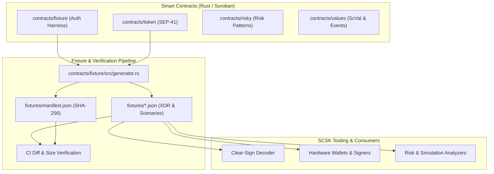

# Architecture of SCSK-Contracts

This document outlines the architectural design, contract purposes, fixture generation pipeline, and a clean-clone contributor walkthrough for the **Soroban Clear-Sign Kit - Smart Contracts (`SCSK-Contracts`)** repository.

For environment prerequisites and quickstart commands, see [README.md](README.md#prerequisites). For contribution and PR guidelines, see [CONTRIBUTING.md](CONTRIBUTING.md).

---

## 1. System Overview & Objectives

The primary objective of `SCSK-Contracts` is to provide canonical smart contracts, test harnesses, and deterministically generated test fixtures for the **Soroban Clear-Sign Kit (SCSK)**. 

Hardware wallets, browser extensions, and transaction analysis tools require reliable test vectors to verify that:
1. Complex authorization trees (`SorobanAuthorizationEntry`) decode into unambiguous, human-readable actions.
2. In-contract transfers, cross-contract calls, and custom account authentications are correctly attributed.
3. Every supported Soroban value type (`ScVal`) is correctly parsed and serialized.
4. Security risks (e.g. unlimited allowances, unauthorized bytecode upgrades, single-step admin transfers) trigger transparent warnings before signing.



---

## 2. Smart Contract Architecture

The repository contains four distinct contracts under [`contracts/`](contracts/), each designed for a specific testing or reference responsibility:

### 2.1. `contracts/token` (SEP-41 Token Reference)
- **Role**: Reference implementation of the [SEP-41 Token Interface](https://github.com/stellar/stellar-protocol/blob/master/ecosystem/sep-0041.md).
- **Interface**: Full compliance with `initialize`, `mint`, `set_admin`, `admin`, `set_authorized`, `authorized`, `allowance`, `approve`, `balance`, `transfer`, `transfer_from`, `burn`, `burn_from`, `decimals`, `name`, and `symbol`.
- **Storage Strategy**:
  - *Instance Storage*: Admin address, token decimals, name, and symbol. Automatically bumped on reads/writes using `INSTANCE_BUMP_AMOUNT` (7 days) and `INSTANCE_LIFETIME_THRESHOLD`.
  - *Persistent Storage*: Account balances (`DataKey::Balance(Address)`) and allowances (`DataKey::Allowance(AllowanceDataKey)`). Automatically extended on access using `BALANCE_BUMP_AMOUNT` (30 days) and `BALANCE_LIFETIME_THRESHOLD`.
- **Invariants**: Proptest-verified invariants:
  - Conservation of total supply across arbitrary operations.
  - Balances never become negative.
  - Allowance never increases upon `transfer_from`.
  - Atomic state rollback on failed invocations.
- **Specification**: See [docs/SEP41-COMPLIANCE.md](docs/SEP41-COMPLIANCE.md).

### 2.2. `contracts/fixture` (Authorization Harness & Fixture Generator)
- **Role**: Exercises the full spectrum of Soroban authorization semantics and generates reference test vectors.
- **Key Modules**:
  - `Forwarder`: Executes standard authorizations (`require_auth`), custom argument authorizations (`require_auth_for_args`), multi-level sub-invocation trees (depth 3+ via `chain_call` and `chain_step`), dual-depth authorization where the same address authorizes at multiple levels (`dual_depth_auth`), contract-to-contract authorization (`authorize_as_current_contract`), and user-defined types (UDTs) `Meta` and `Mode`.
  - `CustomAccount`: Implements `CustomAccountInterface` with `__check_auth` to exercise smart contract wallet account authorization.
  - `generator.rs`: Harness that executes scenarios, captures transaction envelope XDRs, authorization entries, and emitted event streams, writing deterministic JSON fixtures and `manifest.json`.
- **Specification**: See [docs/SCENARIOS.md](docs/SCENARIOS.md) and [fixtures/README.md](fixtures/README.md).

### 2.3. `contracts/risky` (Risk Patterns & Protocol Bounds)
- **Role**: Benign, clearly labeled test-only contract demonstrating high-risk patterns to exercise wallet risk analyzers and simulation diffing engines.
- **Risk Vectors Covered**:
  - `unlimited_approve`: Grants `i128::MAX` allowance to a spender.
  - `approve_fresh_spender`: Grants allowance to an unvetted/fresh address.
  - `set_admin`: Immediate, single-step admin transfer without two-step acceptance.
  - `upgrade_contract`: In-place contract bytecode replacement (`update_current_contract_wasm`).
  - `large_transfer`: Submits very large asset transfers (`i128::MAX / 2`).
  - `oversize_payload` & `deeply_nested_structure`: Tests protocol boundary conditions and deserialization limits without breaching network caps.
- **Specification**: See [docs/RISK-PATTERNS.md](docs/RISK-PATTERNS.md).

### 2.4. `contracts/values` (ScVal & Multi-Topic Event Coverage)
- **Role**: Exercises every value type a Soroban contract call can carry, validating full roundtrip encoding and deserialization across client decoders.
- **Value Types Covered**: Nested `Vec<Vec<String>>`, nested `Map<Symbol, Map<Symbol, i128>>`, tuples `(Symbol, u64, Address)`, `Option<String>`, data enums `CustomEnum`, binary types `Bytes` and `BytesN<32>`, primitive identifiers `String`, `Symbol`, `Address`, large integers `i128`, `u128`, `I256`, `U256`, and temporal types `Duration` and `Timepoint`.
- **Multi-Topic Events**: Emits contract events with up to 4 topics for every value type to test event indexing and topic decoding.
- **Specification**: See [docs/VALUES-TYPES.md](docs/VALUES-TYPES.md).

---

## 3. Fixture Generation & Verification Architecture

Test fixtures in [`fixtures/`](fixtures/) are not manually authored or recorded from ad-hoc networks; they are generated through code from the Soroban test host.

### 3.1. Generation Flow
1. **Host Execution**: The generator in [`contracts/fixture/src/generator.rs`](contracts/fixture/src/generator.rs) initializes a Soroban `Env::default()`.
2. **Scenario Execution**: For each scenario, the contract functions are invoked using mock authorization (`env.mock_all_auths()`).
3. **Capture**:
   - `auth_entries`: Recorded from `env.auths()`, capturing the entire hierarchical authorization tree and base64 `SorobanAuthorizationEntry` XDR.
   - `expected_events`: Captured from `env.events().all()`, recording contract ID, topic list, data value, and base64 `ContractEvent` XDR.
   - `tx_envelope_xdr`: Synthesized base64 `TransactionEnvelope` XDR containing the invocation host function and credentials.
   - `expected_summary`: Human-readable description of what clear-sign decoders should present to users.
4. **Serialization**: Individual scenario files are written as formatted JSON to `fixtures/<scenario_id>.json`.
5. **Integrity Manifest**: `fixtures/manifest.json` is generated with schema version `1.0.0` and SHA-256 digests computed over the raw contents of every scenario file.

### 3.2. Verification & CI Gate
Fixture integrity is enforced continuously:
- **Local Verification**: `cargo test --package fixture generate_and_verify_reproducible_fixtures` regenerates all fixtures in-memory and asserts that they match the committed files bit-for-bit.
- **CI Gate**: Continuous Integration builds contracts, runs fixture generation, and runs `git diff --exit-code fixtures/`. If any uncommitted change or nondeterministic output is detected, CI fails.

---

## 4. Clean-Clone Contributor Walkthrough

Follow these step-by-step instructions in a fresh checkout to verify your local environment, build all artifacts, execute all tests, and confirm fixture reproducibility.

### Step 1: Clone Repository & Enter Directory
```bash
git clone https://github.com/Soroban-Clear-Sign-Kit/SCSK-Contracts.git
cd SCSK-Contracts
```

### Step 2: Ensure Toolchain Prerequisites
Verify Rust toolchain (1.80+) and add the Soroban WASM target:
```bash
rustup target add wasm32v1-none
```
Verify Stellar CLI (v22+) is installed:
```bash
stellar --version
```
*(If Stellar CLI is not installed, install it following [Stellar CLI Documentation](https://developers.stellar.org/docs/tools/developer-tools/cli/stellar-cli).)*

### Step 3: Build Smart Contracts
Compile all four contracts in release mode:
```bash
cargo build --target wasm32v1-none --release
```
Or build via the Stellar CLI:
```bash
stellar contract build
```
Compiled WASM files will be output to `target/wasm32v1-none/release/`:
- `token.wasm`
- `fixture.wasm`
- `risky.wasm`
- `values.wasm`

### Step 4: Verify Bytecode Size Budgets
Soroban contracts must adhere to strict size budgets configured in [`size-budget.json`](size-budget.json):
```bash
python scripts/check-size-budget.py
```
Expected output: All 4 WASM files pass within their allowed thresholds.

### Step 5: Run the Complete Test Suite
Execute all unit tests, property tests, and scenario tests:
```bash
cargo test
```
This runs:
- 13 fixture tests and scenario generator verification
- 8 risky contract pattern and bounds tests
- 44 SEP-41 token compliance and proptest invariant tests
- 18 values contract type and event roundtrip tests

### Step 6: Regenerate & Verify Test Fixtures
Run the deterministic fixture generator and verify that zero diffs are produced:
```bash
cargo test --package fixture generate_and_verify_reproducible_fixtures
git diff --exit-code fixtures/
```
Zero output indicates that all generated JSON fixtures and `manifest.json` match the repository's committed artifacts exactly.

### Step 7: Linting and Code Formatting
Verify that all code complies with style guidelines and Clippy lints:
```bash
cargo fmt --all -- --check
cargo clippy --all-targets -- -D warnings
```

---

## 5. Architectural Reference Links

- **SEP-41 Compliance Details**: [docs/SEP41-COMPLIANCE.md](docs/SEP41-COMPLIANCE.md)
- **Authorization Scenarios & Call Trees**: [docs/SCENARIOS.md](docs/SCENARIOS.md)
- **Risk Patterns & Security Heuristics**: [docs/RISK-PATTERNS.md](docs/RISK-PATTERNS.md)
- **Soroban Value Types Matrix**: [docs/VALUES-TYPES.md](docs/VALUES-TYPES.md)
- **Testnet Deployments & Live Verification**: [docs/DEPLOYMENTS.md](docs/DEPLOYMENTS.md)
- **Fixture Manifest & File Schemas**: [fixtures/README.md](fixtures/README.md)
- **Development & PR Rules**: [CONTRIBUTING.md](CONTRIBUTING.md)

